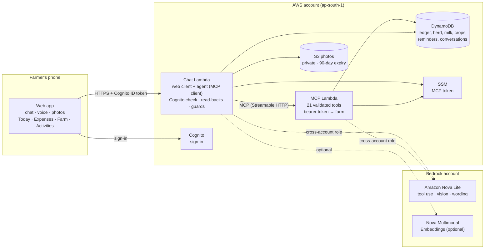

# FarmAssist Agent

> Talk to your farm ledger — every number verified, never guessed.

FarmAssist is a voice-first farm assistant for small dairy and crop farmers in India. A farmer says *"spent 2500 on cattle feed"*, *"Lakshmi gave 8 litres this morning"*, *"harvested 30 quintal of paddy from the north field"* or *"no, it was 2400"*, and FarmAssist keeps the records: expenses, activities, the herd, milk, crops, insurance and reminders. It answers questions from those records, and it can look at a photo of a sick animal or a crop problem.

It is built as a **self-hosted MCP server** (Model Context Protocol 2025-11-25, Streamable HTTP) on AWS Lambda and DynamoDB, with an MCP client/agent driven by **Amazon Nova Lite** on Amazon Bedrock, and a mobile-first web app with voice.

**The rule that shapes everything: the model never decides a fact.** Totals, counts, ages, yields and dates are calculated by server code. Every number a model writes is checked against tool results. Every change is checked before it is saved. Nothing depends on the model being right.

## What it does

| Area | Examples | Tools |
|---|---|---|
| Expenses | "Spent 1200 on diesel", "how much on feed this month?", "no, it was 900" | `record_expense`, `list_expenses`, `get_expense_summary`, `correct_entry` (with an audit trail) |
| Activities | "Vaccinated the brown cow" | `record_farm_activity`, `list_activities`, `get_daily_summary` |
| Herd | "I have 4 cows: Lakshmi, Maya, Geeta and Rita", "rename Rita to Sita", "Maya was sold" | `register_animal`, `update_animal`, `list_animals` |
| Milk | "Lakshmi gave 8 litres in the morning", "how much milk this week?" | `record_milk`, `get_milk_summary` |
| Crops | "Planted paddy in the north field, 2 acres, 50 kg seed", "harvested 30 quintal" | `record_sowing`, `record_harvest`, `list_crops` (yield per acre, harvest vs seed) |
| Insurance and reminders | "Lakshmi is insured with United India until 5 November", "remind me to deworm the calves" | `add_insurance`, `add_reminder`, `complete_reminder`, `list_reminders` |
| Weekly insights | "How was my week?" | `weekly_insights` (Nova Lite wording, checked by two guards) |
| Photo help | 📷 a cow with lumps on the skin, or spotted paddy leaves | chat backend: Nova Lite vision plus curated reference notes |

Money is stored in whole paise, milk in millilitres and mass in grams, so totals are exact. "Today" is India time. The farm comes only from the signed-in identity, never from the model.

## Architecture



- **Two Lambdas, one table, one bucket**, all pay-per-request. The MCP server holds the business rules; the chat Lambda is an MCP client like any other.
- **The browser holds only its own Cognito token**: no AWS keys and no MCP token.
- **Bedrock is in a separate account**, reached through a role that trusts only the two Lambda roles. If Bedrock is unavailable, everything still works: a deterministic parser handles the core commands ("basic mode") and insights use template text.

## How the agent stays honest

These are all deterministic code, and each was added after a failure seen in testing ([docs/model-evaluation.md](docs/model-evaluation.md)):

- **Number check on replies.** A reply containing an amount not found in this turn's tool results (or the farmer's words) is replaced with the server's own text.
- **Claim check.** "Recorded…" / "has been updated" with nothing actually saved is never shown. The model gets one chance to call the tool; otherwise the farmer sees "Nothing was saved."
- **Only what the farmer said.** Every number and identifier in a change must appear in what the farmer said (lakh, thousand and k are understood). Live, Nova invented a policy number and a cover amount; those are now dropped.
- **Pre-checks before anything is asked or saved.** Arguments are checked against the tool's own JSON Schema. Placeholders ("N/A", ₹0) are removed. Ids must have come from this conversation (models invent ids), and retry ids are managed by the agent, not the model.
- **Voice read-back.** Speech can be misheard, so a spoken change is read back exactly as it will be saved ("Shall I register 4 cows: Lakshmi (HF, born 2022-07-10), Maya, Geeta and Rita?"). It is saved only after "yes", "haan" or "aama", or a tap. The question is built by code from the tool arguments.
- **Weekly insights: two guards.** The number guard checks every figure exists in the calculated facts. The meaning guard checks each amount or percentage is attached to the right category, and that claims about last week match.
- **Photo help: the model describes, the notes advise.** Nova Lite reports only what it sees. The answer is assembled from curated notes, says "not a diagnosis", and escalates urgent signs and reportable diseases to the veterinarian.
- **Server rules.** Duplicate-safe retries (also under concurrent requests), optimistic locking with an audit trail for corrections, names that never get guessed (an unknown name lists the options), and "other" expenses that need a note.

## Status

| Part | State |
|---|---|
| MCP server, 21 tools, DynamoDB, auth | Deployed; smoke 19/19; concurrency and pagination verified on the real table |
| Agent with Nova Lite (cross-account role) | Deployed. Evaluation 12/13 per run; the 17-message farm scenario stores 10/10 checks correctly, in memory and on the live stack |
| Web client (sign-in, Chat, Today, Expenses, Farm, Activities) | Deployed; used on a phone |
| Voice (English, Hindi, Tamil) with read-back | Deployed; tested on a phone with a real microphone |
| Photo help | Deployed; tested with generated pictures and the full UI path. **Diagnostic accuracy not measured** (needs labelled farm photos) |
| Weekly insights wording by Nova Lite | Live: deployed server returns Nova Lite wording with both guards passing (15/15 in evaluation after one retry); guarded template if Bedrock fails |
| Nova Multimodal Embeddings for retrieval | Live (hybrid with keyword). Different-wording and Hindi/Tamil queries: hit@1 16/18 vs keyword 10/18; keyword alone if embeddings fail |
| Alexa+ | **Not connected**: the Alexa+ developer tools are partner-only. FarmAssist is shown through its own web client. See [FRICTION.md](FRICTION.md) |

Full history and evidence: [docs/progress.md](docs/progress.md).

## Run it locally

Node.js 22 (22.19+ recommended).

```bash
npm ci
cp .env.example .env.local      # set FARMASSIST_API_TOKEN (32+ characters)
npm test                        # 365 tests
npm run build:web
npm run start:chat -- --seed    # web app on http://127.0.0.1:5173 with a sample farm (in memory, dev sign-in)
```

To chat through Nova Lite locally, set `AGENT_MODEL_ID=apac.amazon.nova-lite-v1:0` and `BEDROCK_AWS_PROFILE=<profile for the Bedrock account>` before `start:chat`. The MCP server alone: `npm run start:local` (http://127.0.0.1:3000/mcp), then `npm run smoke -- http://127.0.0.1:3000/mcp`.

## Deploy to AWS

You need the [AWS SAM CLI](https://docs.aws.amazon.com/serverless-application-model/latest/developerguide/install-sam-cli.html) and credentials for the target account. All steps are idempotent.

1. **Token.** CloudFormation cannot create SecureStrings, so create it once:

   ```bash
   aws ssm put-parameter --region ap-south-1 --name /farmassist/dev/api-token --type SecureString --value "<token of 32+ characters>"
   ```

2. **Build and deploy.** If `sam build` cannot find esbuild, put `node_modules/.bin` on the PATH first; in PowerShell: `$env:PATH = "$PWD\node_modules\.bin;$env:PATH"`.

   ```bash
   npm ci && npm run build:web && sam build
   sam deploy --stack-name farmassist-dev --region ap-south-1 --resolve-s3 --capabilities CAPABILITY_IAM --no-confirm-changeset --no-fail-on-empty-changeset --parameter-overrides AgentModelId=apac.amazon.nova-lite-v1:0 AgentBedrockRoleArn=<role ARN> BedrockModelId=apac.amazon.nova-lite-v1:0 BedrockRoleArn=<role ARN>
   ```

   Without the Bedrock parameters, everything still deploys and runs in basic mode. Creating the Bedrock role is covered in [docs/bedrock-access.md](docs/bedrock-access.md).

3. **Sign-in user.** `UserPoolId` is a stack output. Choose your own temporary password; it is replaced at first sign-in:

   ```bash
   aws cognito-idp admin-create-user --region ap-south-1 --user-pool-id <UserPoolId> --username <name> --user-attributes Name=name,Value="<Display name>" Name=custom:farmId,Value=demo-farm --temporary-password "<temporary password>" --message-action SUPPRESS
   ```

4. **Check it.** Open the `WebAppUrl` output, and run the checks below against the `McpEndpoint` output.

## Tests and evaluations

| Command | What it checks |
|---|---|
| `npm test` | 365 unit, protocol, Lambda and API tests (mocked AWS) |
| `npm run smoke -- <McpEndpoint>` | 19 protocol and tool checks against a running server |
| `npm run live-hardening -- <McpEndpoint>` | Simultaneous retries and corrections, and pagination, on the real table |
| `npm run agent-eval -- --runs=2 <modelId>` | 13 conversation cases scored on tool choice, arguments, writes and reply style |
| `npm run farm-scenario` | 17-message voice conversation, then checks the stored records (`FARMASSIST_MCP_URL` runs it against a deployed stack and reads DynamoDB directly) |
| `npm run narration-eval -- --runs=3 <modelId>` | Weekly-insight wording on 5 weeks, through both guards |
| `npm run retrieval-eval` | Reference-note retrieval on 24 labelled descriptions |

## Cost

Measured: the application account has cost **$0.000065 so far this month** (Lambda, DynamoDB, S3, Cognito, SSM and logs are all within the free tier at demo scale). Bedrock is billed to the Bedrock account. Nova Lite is priced per token; a chat turn sends the tool list (about 3,000 to 6,000 tokens), so a turn costs a small fraction of a US cent, and a photo is similar. Check the current [Amazon Bedrock pricing](https://aws.amazon.com/bedrock/pricing/). Guards in place: pay-per-request everything, $1 monthly and zero-spend budgets on the account, 14-day log retention, 90-day photo expiry, and an optional `ReservedConcurrency` cap.

## Teardown

```bash
sam delete --stack-name farmassist-dev --region ap-south-1
```

Kept on purpose, so farm data cannot be lost by accident: the DynamoDB table `farmassist-dev`, the photo bucket (empty it, then delete it), and the SSM parameter. Delete them by hand when you no longer need them. In the Bedrock account, delete the role used for FarmAssist.

## Documentation

- [docs/progress.md](docs/progress.md): every step, what was checked, what is still open
- [docs/model-evaluation.md](docs/model-evaluation.md): Nova Lite vs Micro, and each agent fix with the failure that caused it
- [docs/bedrock-access.md](docs/bedrock-access.md): accounts, model access and the cross-account role
- [docs/demo-script.md](docs/demo-script.md): a three-minute demo
- [docs/data-model.md](docs/data-model.md), [docs/number-guard.md](docs/number-guard.md), [docs/protocol-tests.md](docs/protocol-tests.md), [FRICTION.md](FRICTION.md)

## License

[MIT](LICENSE)
